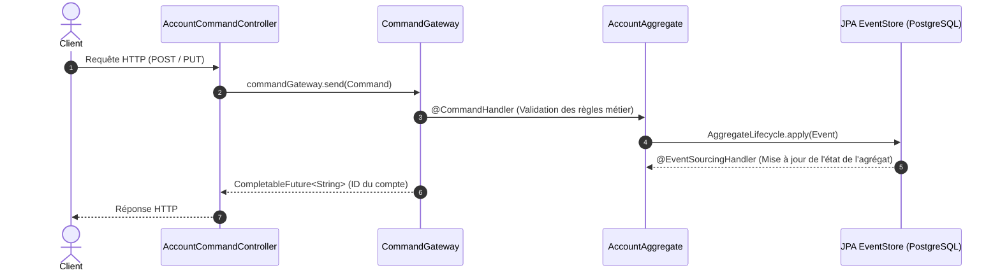

# Gestion de Comptes Bancaires — Event Sourcing & CQRS avec Spring Boot et Axon Framework

Ce projet met en œuvre une architecture **CQRS** (*Command Query Responsibility Segregation*) et **Event Sourcing** pour la gestion de comptes bancaires à l'aide de **Spring Boot** et **Axon Framework**.

Au lieu de stocker uniquement l'état courant d'un compte, chaque modification (création, activation, crédit, débit, changement de statut) est capturée sous forme d'**événement immuable** persisté dans un **Event Store** relationnel (**PostgreSQL** via JPA), sans dépendre d'Axon Server.

---

## Table des matières

1. [Architecture & Concepts](#architecture--concepts)
2. [Stack Technique](#stack-technique)
3. [Structure du Projet](#structure-du-projet)
4. [Modèle Métier & Règles de Validation](#modèle-métier--règles-de-validation)
5. [Prérequis & Installation](#prérequis--installation)
6. [Référence de l'API REST](#référence-de-lapi-rest)
7. [Scénario de Test Complet (cURL)](#scénario-de-test-complet-curl)

---

## Architecture & Concepts

### Flux de traitement (Command Side & Event Sourcing)



### Composants clés d'Axon utilisés

- **Commands (`AddAccountCommand`, `CreditAccountCommand`, `DebitAccountCommand`, `UpdateStatusCommand`)** : Expriment une intention de modification de l'état du système. L'identifiant cible est annoté avec `@TargetAggregateIdentifier`.
- **Aggregate (`AccountAggregate`)** : Entité métier centrale annotée avec `@Aggregate`.
  - Les méthodes/constructeurs `@CommandHandler` valident les règles métier et publient les événements via `AggregateLifecycle.apply(...)`.
  - Les méthodes `@EventSourcingHandler` reconstruisent et mettent à jour l'état interne de l'agrégat (`accountId`, `balance`, `currency`, `status`) à partir de la séquence d'événements.
- **Events (`AddAccountEvent`, `CreditAccountEvent`, `DebitAccountEvent`, `UpdateStatusEvent`)** : Représentent des faits passés immuables stockés au format JSON dans l'Event Store.
- **JPA Event Storage Engine (`AxonConfig`)** : Configure Axon pour utiliser **PostgreSQL** via JPA (`JpaEventStorageEngine`) et sérialiser les événements en **JSON** avec `JacksonSerializer` (le connecteur `axon-server-connector` est exclu).

---

## Stack Technique

| Technologie | Version / Détail | Rôle |
| :--- | :--- | :--- |
| **Java** | 21 | Langage principal |
| **Spring Boot** | 4.1.2 | Framework applicatif (Web MVC, Data JPA) |
| **Axon Framework** | 4.10.3 | Implémentation CQRS & Event Sourcing |
| **PostgreSQL** | 15 (Docker) | Base de données de l'Event Store (`es_account_db`) |
| **SpringDoc OpenAPI** | 3.2.0 | Documentation interactive Swagger UI |
| **Lombok** | — | Réduction du code boilerplate (`@Getter`, `@AllArgsConstructor`, `@Slf4j`) |

---

## Structure du Projet

```text
es-cqrs/
├── compose.yml                                      # Conteneur PostgreSQL 15 (port 5434)
├── pom.xml                                          # Configuration Maven et dépendances
└── src/main/
    ├── java/com/enset/escqrs/
    │   ├── EsCqrsApplication.java                   # Point d'entrée Spring Boot & @EntityScan Axon JPA
    │   ├── conf/
    │   │   └── AxonConfig.java                      # Configuration JpaEventStorageEngine & JacksonSerializer
    │   ├── enumirations/
    │   │   └── AccountStatus.java                   # Statuts : CREATED, ACTIVATED, SUSPENDED, BLOCKED
    │   ├── commands/
    │   │   ├── aggregate/
    │   │   │   └── AccountAggregate.java            # Agrégat gérant les commandes et l'Event Sourcing
    │   │   ├── commands/
    │   │   │   ├── AddAccountCommand.java           # Commande de création de compte
    │   │   │   ├── CreditAccountCommand.java        # Commande de crédit
    │   │   │   ├── DebitAccountCommand.java         # Commande de débit
    │   │   │   └── UpdateStatusCommand.java         # Commande de changement de statut
    │   │   ├── controllers/
    │   │   │   └── AccountCommandController.java    # Endpoints REST (/commands/accounts/*)
    │   │   └── dtos/
    │   │       ├── AddNewAccountRequestDTO.java     # Record DTO création
    │   │       ├── CreditAccountDTO.java            # Record DTO crédit
    │   │       ├── DebitAccountDTO.java             # Record DTO débit
    │   │       └── UpdateAccountDTO.java            # Record DTO mise à jour du statut
    │   └── events/
    │       ├── AddAccountEvent.java                 # Événement de création
    │       ├── CreditAccountEvent.java              # Événement de crédit
    │       ├── DebitAccountEvent.java               # Événement de débit
    │       └── UpdateStatusEvent.java               # Événement de changement de statut
    └── resources/
        └── application.properties                   # Configuration serveur (8066), PostgreSQL et Axon
```

---

## Modèle Métier & Règles de Validation

### Cycle de vie du statut (`AccountStatus`)

- `CREATED` : Statut initial attribué automatiquement lors de la création d'un compte.
- `ACTIVATED` : Compte actif autorisant les opérations de crédit et de débit.
- `SUSPENDED` : Compte suspendu.
- `BLOCKED` : Compte bloqué.

### Règles métier appliquées dans `AccountAggregate`

1. **Création (`AddAccountCommand`)** :
   - Le solde initial (`initialBalance`) doit être strictement positif (`> 0`), sinon une exception `"balance must be positive"` est levée.
   - Le compte est initialisé à l'état `CREATED`.
2. **Crédit (`CreditAccountCommand`)** :
   - Le compte doit avoir le statut `ACTIVATED` (`"the account must be active"`).
   - Le montant crédité (`amount`) doit être strictement positif (`> 0`), sinon `"amount must be positive"`.
3. **Débit (`DebitAccountCommand`)** :
   - Le compte doit avoir le statut `ACTIVATED` (`"the account must be active"`).
   - Le solde disponible (`balance`) doit être supérieur ou égal au montant demandé (`"your solde is insufficient"`).
4. **Mise à jour du statut (`UpdateStatusCommand`)** :
   - Permet de faire évoluer le statut du compte (ex. passer de `CREATED` à `ACTIVATED`).

---

## Prérequis & Installation

### Prérequis

- **Java 21+**
- **Maven 3.9+** (ou utilisation du wrapper `./mvnw` inclus)
- **Docker & Docker Compose**

### 1. Démarrer la base de données PostgreSQL

Le fichier `compose.yml` lance une instance PostgreSQL 15 exposée sur le port local **`5434`** :

```bash
docker compose up -d
```

Paramètres configurés dans `compose.yml` et `application.properties` :
- **Hôte / Port** : `localhost:5434`
- **Base de données** : `es_account_db`
- **Utilisateur / Mot de passe** : `axon` / `axon`

### 2. Compiler et démarrer l'application

```bash
./mvnw spring-boot:run
```

L'application démarre sur le port **`8066`** :
- **URL de base** : `http://localhost:8066`
- **Swagger UI** : `http://localhost:8066/swagger-ui/index.html`

---

## Référence de l'API REST

Tous les endpoints sont exposés sous le préfixe `/commands/accounts`.

### 1. Créer un compte
- **Méthode / URL** : `POST /commands/accounts/add`
- **Corps de la requête (JSON)** :
  ```json
  {
    "initialBalance": 1000.0,
    "currency": "MAD"
  }
  ```
- **Réponse** : Identifiant UUID du compte créé (ex. `"4f9f7d6e-2b1a-4c3e-8a9b-123456789abc"`).

### 2. Mettre à jour le statut d'un compte
- **Méthode / URL** : `PUT /commands/accounts/updateStatus`
- **Corps de la requête (JSON)** :
  ```json
  {
    "accountId": "4f9f7d6e-2b1a-4c3e-8a9b-123456789abc",
    "status": "ACTIVATED"
  }
  ```
  *(Valeurs possibles pour `status` : `CREATED`, `ACTIVATED`, `SUSPENDED`, `BLOCKED`)*

### 3. Créditer un compte
- **Méthode / URL** : `POST /commands/accounts/credit`
- **Corps de la requête (JSON)** :
  ```json
  {
    "accountId": "4f9f7d6e-2b1a-4c3e-8a9b-123456789abc",
    "amount": 500.0,
    "currency": "MAD"
  }
  ```

### 4. Débiter un compte
- **Méthode / URL** : `POST /commands/accounts/debit`
- **Corps de la requête (JSON)** :
  ```json
  {
    "accountId": "4f9f7d6e-2b1a-4c3e-8a9b-123456789abc",
    "amount": 300.0,
    "currency": "MAD"
  }
  ```

### 5. Consulter le flux d'événements d'un compte (Event Store)
- **Méthode / URL** : `GET /commands/accounts/events/{accountId}`
- **Description** : Retourne la liste ordonnée de tous les événements (`DomainEventMessage`) appliqués à l'agrégat depuis sa création.

---

## Scénario de Test Complet (cURL)

```bash
# 1. Créer un nouveau compte (retourne l'UUID du compte)
ACCOUNT_ID=$(curl -s -X POST http://localhost:8066/commands/accounts/add \
  -H "Content-Type: application/json" \
  -d '{"initialBalance": 1500, "currency": "MAD"}')

echo "Compte créé : $ACCOUNT_ID"

# 2. Activer le compte (obligatoire avant tout crédit ou débit)
curl -X PUT http://localhost:8066/commands/accounts/updateStatus \
  -H "Content-Type: application/json" \
  -d "{\"accountId\": \"$ACCOUNT_ID\", \"status\": \"ACTIVATED\"}"

# 3. Créditer le compte de 500 MAD
curl -X POST http://localhost:8066/commands/accounts/credit \
  -H "Content-Type: application/json" \
  -d "{\"accountId\": \"$ACCOUNT_ID\", \"amount\": 500, \"currency\": \"MAD\"}"

# 4. Débiter le compte de 200 MAD
curl -X POST http://localhost:8066/commands/accounts/debit \
  -H "Content-Type: application/json" \
  -d "{\"accountId\": \"$ACCOUNT_ID\", \"amount\": 200, \"currency\": \"MAD\"}"

# 5. Lire l'historique des événements dans l'Event Store
curl -s http://localhost:8066/commands/accounts/events/$ACCOUNT_ID | jq
```
