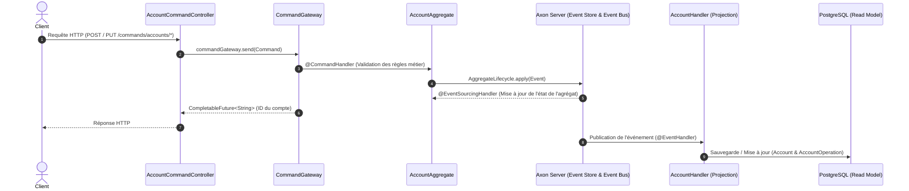
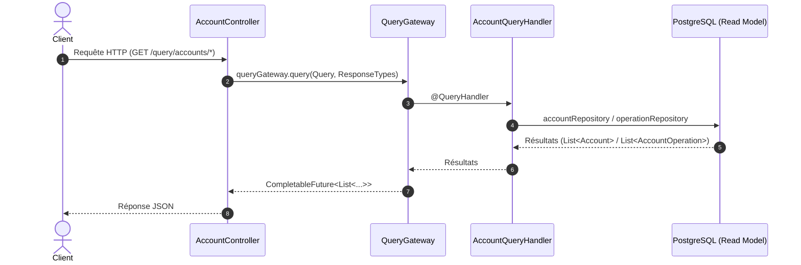

# Gestion de Comptes Bancaires — Event Sourcing & CQRS avec Spring Boot et Axon Framework

Ce projet met en œuvre une architecture **CQRS** (*Command Query Responsibility Segregation*) et **Event Sourcing** complète (**Command Side** et **Query Side**) pour la gestion de comptes bancaires à l'aide de **Spring Boot**, **Axon Framework**, **Axon Server** et **PostgreSQL**.

- **Command Side & Event Store (Axon Server)** : Chaque modification d'état (création, activation, crédit, débit, changement de statut) est capturée sous forme d'**événement immuable** persisté dans l'**Event Store d'Axon Server** et routée via le bus d'événements d'Axon.
- **Query Side / Read Model (PostgreSQL)** : Les événements publiés sont consommés de manière asynchrone par des projections (`@EventHandler`) qui mettent à jour une base relationnelle **PostgreSQL** (`Account`, `AccountOperation`) optimisée pour la lecture via le `QueryGateway`.

---

## Table des matières

1. [Architecture & Concepts](#architecture--concepts)
2. [Stack Technique](#stack-technique)
3. [Structure du Projet](#structure-du-projet)
4. [Modèle Métier & Règles de Validation](#modèle-métier--règles-de-validation)
5. [Prérequis & Installation](#prérequis--installation)
6. [Référence de l'API REST](#référence-de-lapi-rest)
7. [Scénario de Test Complet (cURL)](#scénario-de-test-complet-curl)

---

## Architecture & Concepts

### 1. Flux d'écriture et projection (Command Side → Event Store → Query Side)



### 2. Flux de lecture (Query Side)



### Composants clés d'Axon utilisés

- **Command Side (`com.enset.escqrs.commands`)** :
  - **Commands (`AddAccountCommand`, `CreditAccountCommand`, `DebitAccountCommand`, `UpdateStatusCommand`)** : Expriment une intention de modification de l'état du système. L'identifiant cible est annoté avec `@TargetAggregateIdentifier`.
  - **Aggregate (`AccountAggregate`)** : Entité métier centrale annotée avec `@Aggregate`.
    - Les méthodes/constructeurs `@CommandHandler` valident les règles métier et publient les événements via `AggregateLifecycle.apply(...)`.
    - Les méthodes `@EventSourcingHandler` reconstruisent et mettent à jour l'état interne de l'agrégat (`accountId`, `balance`, `currency`, `status`) à partir de la séquence d'événements.
- **Events (`com.enset.escqrs.events`)** :
  - `AddAccountEvent`, `CreditAccountEvent`, `DebitAccountEvent`, `UpdateStatusEvent` : Représentent des faits passés immuables stockés au format JSON dans Axon Server.
- **Query Side (`com.enset.escqrs.query`)** :
  - **Projections (`AccountHandler`)** : Composant annoté avec `@EventHandler` qui écoute les événements et synchronise les entités JPA `Account` et `AccountOperation` dans PostgreSQL.
  - **Queries (`GetAllAccountQuery`, `GetAllOperations`)** : Objets de requête envoyés via `QueryGateway`.
  - **Query Handlers (`AccountQueryHandler`)** : Méthodes annotées avec `@QueryHandler` qui interrogent `AccountRepository` et `OperationRepository`.

---

## Stack Technique

| Technologie | Version / Détail | Rôle |
| :--- | :--- | :--- |
| **Java** | 21 | Langage principal |
| **Spring Boot** | 4.1.2 | Framework applicatif (Web MVC, Data JPA) |
| **Axon Framework** | 4.10.3 | Implémentation CQRS & Event Sourcing |
| **Axon Server** | `axoniq/axonserver:latest` | Event Store & Message Router (Command/Event/Query Bus) |
| **PostgreSQL** | 15 (Docker) | Base de données relationnelle du Query Side (`es_account_db`) |
| **SpringDoc OpenAPI** | 3.2.0 | Documentation interactive Swagger UI |
| **Lombok** | — | Réduction du code boilerplate (`@Getter`, `@Builder`, `@RequiredArgsConstructor`, `@Slf4j`) |

---

## Structure du Projet

```text
es-cqrs/
├── compose.yml                                      # Conteneurs Docker : Axon Server (8024/8124) & PostgreSQL 15 (5434)
├── pom.xml                                          # Configuration Maven et dépendances
└── src/main/
    ├── java/com/enset/escqrs/
    │   ├── EsCqrsApplication.java                   # Point d'entrée Spring Boot & @EntityScan
    │   ├── conf/
    │   │   └── AxonConfig.java                      # Configuration alternative JPA EventStore (désactivée au profit d'Axon Server)
    │   ├── enumirations/
    │   │   ├── AccountStatus.java                   # Statuts : CREATED, ACTIVATED, SUSPENDED, BLOCKED
    │   │   └── OperationType.java                   # Types d'opération : CREDIT, DEBIT
    │   ├── commands/
    │   │   ├── aggregate/
    │   │   │   └── AccountAggregate.java            # Agrégat gérant les commandes et l'Event Sourcing
    │   │   ├── commands/
    │   │   │   ├── AddAccountCommand.java           # Commande de création de compte
    │   │   │   ├── CreditAccountCommand.java        # Commande de crédit
    │   │   │   ├── DebitAccountCommand.java         # Commande de débit
    │   │   │   └── UpdateStatusCommand.java         # Commande de changement de statut
    │   │   ├── controllers/
    │   │   │   └── AccountCommandController.java    # Endpoints REST d'écriture (/commands/accounts/*)
    │   │   └── dtos/
    │   │       ├── AddNewAccountRequestDTO.java     # Record DTO création
    │   │       ├── CreditAccountDTO.java            # Record DTO crédit
    │   │       ├── DebitAccountDTO.java             # Record DTO débit
    │   │       └── UpdateAccountDTO.java            # Record DTO mise à jour du statut
    │   ├── events/
    │   │   ├── AddAccountEvent.java                 # Événement de création
    │   │   ├── CreditAccountEvent.java              # Événement de crédit
    │   │   ├── DebitAccountEvent.java               # Événement de débit
    │   │   └── UpdateStatusEvent.java               # Événement de changement de statut
    │   └── query/
    │       ├── controller/
    │       │   └── AccountController.java           # Endpoints REST de lecture (/query/accounts/*)
    │       ├── entity/
    │       │   ├── Account.java                     # Entité JPA représentant l'état courant d'un compte
    │       │   └── AccountOperation.java            # Entité JPA représentant une opération (CREDIT / DEBIT)
    │       ├── handlers/
    │       │   ├── AccountHandler.java              # @EventHandler : projection des événements vers PostgreSQL
    │       │   └── AccountQueryHandler.java         # @QueryHandler : traitement des requêtes de lecture
    │       ├── querys/
    │       │   ├── GetAllAccountQuery.java          # Record Query : lister tous les comptes
    │       │   └── GetAllOperations.java            # Record Query : lister les opérations d'un compte
    │       └── repository/
    │           ├── AccountRepository.java           # Repository Spring Data JPA pour Account
    │           └── OperationRepository.java         # Repository Spring Data JPA pour AccountOperation
    └── resources/
        └── application.properties                   # Configuration serveur (8066), PostgreSQL, Axon Server et Jackson
```

---

## Modèle Métier & Règles de Validation

### Cycle de vie du statut (`AccountStatus`)

- `CREATED` : Statut initial attribué automatiquement lors de la création d'un compte.
- `ACTIVATED` : Compte actif autorisant les opérations de crédit et de débit.
- `SUSPENDED` : Compte suspendu.
- `BLOCKED` : Compte bloqué.

### Règles métier appliquées dans `AccountAggregate`

1. **Création (`AddAccountCommand`)** :
   - Le solde initial (`initialBalance`) doit être strictement positif (`> 0`), sinon une exception `"balance must be positive"` est levée.
   - Le compte est initialisé à l'état `CREATED`.
2. **Crédit (`CreditAccountCommand`)** :
   - Le compte doit avoir le statut `ACTIVATED` (`"the account must be active"`).
   - Le montant crédité (`amount`) doit être strictement positif (`> 0`), sinon `"amount must be positive"`.
   - Génère côté Query une entrée `AccountOperation` de type `CREDIT` et incrémente le solde du compte.
3. **Débit (`DebitAccountCommand`)** :
   - Le compte doit avoir le statut `ACTIVATED` (`"the account must be active"`).
   - Le solde disponible (`balance`) doit être supérieur ou égal au montant demandé (`"your solde is insufficient"`).
   - Génère côté Query une entrée `AccountOperation` de type `DEBIT` et décrémente le solde du compte.
4. **Mise à jour du statut (`UpdateStatusCommand`)** :
   - Permet de faire évoluer le statut du compte (ex. passer de `CREATED` à `ACTIVATED`) et répercute la modification dans la table `Account`.

---

## Prérequis & Installation

### Prérequis

- **Java 21+**
- **Maven 3.9+** (ou utilisation du wrapper `./mvnw` inclus)
- **Docker & Docker Compose**

### 1. Démarrer l'infrastructure (Axon Server & PostgreSQL)

Le fichier `es-cqrs/compose.yml` démarre **Axon Server** (en mode standalone) et **PostgreSQL 15** :

```bash
cd es-cqrs
docker compose up -d
```

Services démarrés :
- **Axon Server** :
  - Dashboard Web UI : `http://localhost:8024`
  - Port gRPC (connexion application) : `localhost:8124`
- **PostgreSQL (Query Side)** :
  - Hôte / Port : `localhost:5434`
  - Base de données : `es_account_db`
  - Utilisateur / Mot de passe : `axon` / `axon`

### 2. Compiler et démarrer l'application

```bash
./mvnw spring-boot:run
```

L'application démarre sur le port **`8066`** :
- **URL de base** : `http://localhost:8066`
- **Swagger UI** : `http://localhost:8066/swagger-ui/index.html`
- **Axon Server Dashboard** : `http://localhost:8024`

---

## Référence de l'API REST

### Command Side (`/commands/accounts`)

#### 1. Créer un compte
- **Méthode / URL** : `POST /commands/accounts/add`
- **Corps de la requête (JSON)** :
  ```json
  {
    "initialBalance": 1000.0,
    "currency": "MAD"
  }
  ```
- **Réponse** : Identifiant UUID du compte créé (ex. `"4f9f7d6e-2b1a-4c3e-8a9b-123456789abc"`).

#### 2. Mettre à jour le statut d'un compte
- **Méthode / URL** : `PUT /commands/accounts/updateStatus`
- **Corps de la requête (JSON)** :
  ```json
  {
    "accountId": "4f9f7d6e-2b1a-4c3e-8a9b-123456789abc",
    "status": "ACTIVATED"
  }
  ```
  *(Valeurs possibles pour `status` : `CREATED`, `ACTIVATED`, `SUSPENDED`, `BLOCKED`)*

#### 3. Créditer un compte
- **Méthode / URL** : `POST /commands/accounts/credit`
- **Corps de la requête (JSON)** :
  ```json
  {
    "accountId": "4f9f7d6e-2b1a-4c3e-8a9b-123456789abc",
    "amount": 500.0,
    "currency": "MAD"
  }
  ```

#### 4. Débiter un compte
- **Méthode / URL** : `POST /commands/accounts/debit`
- **Corps de la requête (JSON)** :
  ```json
  {
    "accountId": "4f9f7d6e-2b1a-4c3e-8a9b-123456789abc",
    "amount": 300.0,
    "currency": "MAD"
  }
  ```

#### 5. Consulter le flux d'événements d'un compte (Event Store)
- **Méthode / URL** : `GET /commands/accounts/events/{accountId}`
- **Description** : Retourne la liste ordonnée de tous les événements (`DomainEventMessage`) appliqués à l'agrégat depuis sa création dans l'Event Store.

---

### Query Side (`/query/accounts`)

#### 1. Lister tous les comptes (Read Model)
- **Méthode / URL** : `GET /query/accounts/all`
- **Description** : Interroge la vue matérialisée PostgreSQL via `GetAllAccountQuery` et retourne la liste des comptes avec leur solde et statut actuels.
- **Exemple de réponse** :
  ```json
  [
    {
      "accountId": "4f9f7d6e-2b1a-4c3e-8a9b-123456789abc",
      "balance": 1200.0,
      "createdAt": "2026-11-19T12:00:00Z",
      "status": "ACTIVATED",
      "currency": "MAD"
    }
  ]
  ```

#### 2. Lister l'historique des opérations d'un compte
- **Méthode / URL** : `GET /query/accounts/{accountId}/operations`
- **Description** : Interroge PostgreSQL via `GetAllOperations` et retourne toutes les opérations (`CREDIT`, `DEBIT`) enregistrées sur ce compte.
- **Exemple de réponse** :
  ```json
  [
    {
      "id": 1,
      "date": "2026-11-19T12:01:00Z",
      "amount": 500.0,
      "type": "CREDIT",
      "currency": "MAD",
      "account": {
        "accountId": "4f9f7d6e-2b1a-4c3e-8a9b-123456789abc",
        "balance": 1200.0,
        "createdAt": "2026-11-19T12:00:00Z",
        "status": "ACTIVATED",
        "currency": "MAD"
      }
    }
  ]
  ```

---

## Scénario de Test Complet (cURL)

```bash
# 1. Créer un nouveau compte (retourne l'UUID du compte)
ACCOUNT_ID=$(curl -s -X POST http://localhost:8066/commands/accounts/add \
  -H "Content-Type: application/json" \
  -d '{"initialBalance": 1500, "currency": "MAD"}')

echo "Compte créé : $ACCOUNT_ID"

# 2. Activer le compte (obligatoire avant tout crédit ou débit)
curl -X PUT http://localhost:8066/commands/accounts/updateStatus \
  -H "Content-Type: application/json" \
  -d "{\"accountId\": \"$ACCOUNT_ID\", \"status\": \"ACTIVATED\"}"

# 3. Créditer le compte de 500 MAD
curl -X POST http://localhost:8066/commands/accounts/credit \
  -H "Content-Type: application/json" \
  -d "{\"accountId\": \"$ACCOUNT_ID\", \"amount\": 500, \"currency\": \"MAD\"}"

# 4. Débiter le compte de 200 MAD
curl -X POST http://localhost:8066/commands/accounts/debit \
  -H "Content-Type: application/json" \
  -d "{\"accountId\": \"$ACCOUNT_ID\", \"amount\": 200, \"currency\": \"MAD\"}"

# 5. Lire l'historique des événements dans l'Event Store (Command Side)
curl -s http://localhost:8066/commands/accounts/events/$ACCOUNT_ID | jq

# 6. Consulter l'état projeté des comptes (Query Side - PostgreSQL)
curl -s http://localhost:8066/query/accounts/all | jq

# 7. Consulter les opérations de crédit/débit du compte (Query Side - PostgreSQL)
curl -s http://localhost:8066/query/accounts/$ACCOUNT_ID/operations | jq
```
